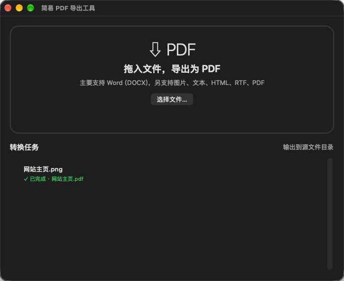

# 简易 PDF 导出工具

`simple-pdf-exporter-macos` 是一款完全本地运行的 macOS 简易 PDF 导出工具。拖入文件后，PDF 自动保存到源文件所在目录。

主要支持 Word 文档（DOCX，也兼容 DOC、ODT），另支持图片（PNG/JPG/HEIC/TIFF/GIF/BMP）、TXT、Markdown、CSV、HTML、RTF 和 PDF。
若目标文件已存在，会自动使用 `-2`、`-3` 后缀，绝不覆盖原文件。

Word 文档由本机 Pages 直接导出，以保留字体、表格与分页。首次转换时请允许本工具控制 Pages。

运行 `./build-app.sh` 构建，应用位于 `dist/简易PDF导出工具.app`。

运行 `./build-dmg.sh` 制作同事可安装的 DMG，输出位于 `dist/简易PDF导出工具-1.1.dmg`。

